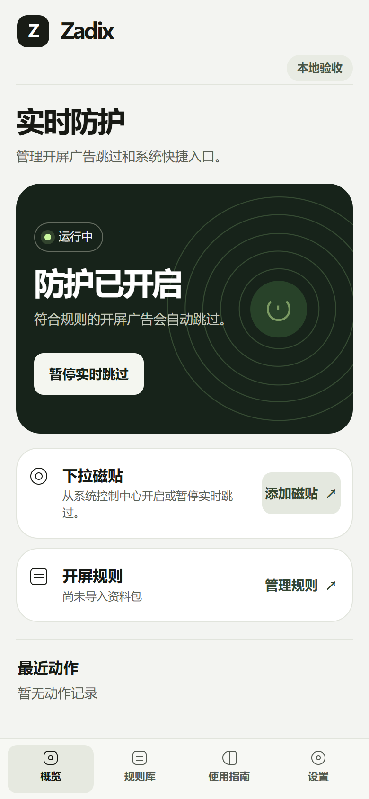
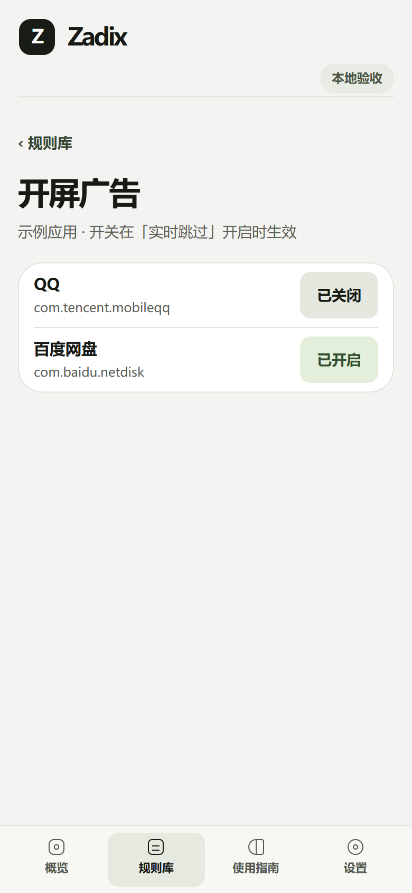

<p align="center">
  
</p>

<h1 align="center">Zadix</h1>

<p align="center">Android 开屏广告跳过、按应用控制、下拉磁贴与规则资料包。</p>

<p align="center">
  <a href="https://github.com/17hwliao/zadix/releases/tag/v1.0.0">下载 APK</a> ·
  <a href="#开始使用">开始使用</a> ·
  <a href="#界面预览">界面预览</a> ·
  <a href="#技术栈">技术栈</a> ·
  <a href="LICENSE">GPL-3.0</a>
</p>

## 下载

**v1.0.0（Build 28）** · Android 14 或更新版本

[下载 APK](https://github.com/17hwliao/zadix/releases/download/v1.0.0/Zadix-1.0.0-build28.apk) · [SHA-256 校验](https://github.com/17hwliao/zadix/releases/download/v1.0.0/SHA256SUMS-build28.txt) · [发布说明](https://github.com/17hwliao/zadix/releases/tag/v1.0.0)

旧的正式签名包可直接覆盖安装。调试签名包需要先导出资料包，再卸载并安装正式包。已安装 Build 27 的用户可从「设置 → 检查更新」找到本次维护包，并在发布页下载安装。

## 开始使用

1. 安装后打开 Zadix，按引导启用「Zadix · 实时跳过」无障碍服务。
2. 从概览添加「实时跳过」磁贴。下拉控制中心短按可暂停或恢复，长按打开 Zadix。
3. 在「规则库 → 开屏广告」按应用管理拦截。应用内置部分开屏规则，也可导入、保存或分享 `.zadixsource`。[资料包格式](source-engine/README.md)

## 界面预览

<p align="center">
  
  
</p>

图片来自浏览器预览，使用示例应用和模拟运行状态。

## 功能范围

| 功能 | 当前行为 |
| --- | --- |
| 开屏跳过 | 无障碍服务匹配受支持的广告规则，通过后尝试点击跳过。覆盖取决于应用版本、广告样式和所用资料包。 |
| 跳过提示 | 具备关闭证据时，底部显示约 2 秒的「Zadix」圆角提示。当前关闭确认覆盖百度网盘指定场景和受控样本。其他场景可能只记录动作已提交。 |
| 应用控制 | 对有可用开屏规则的本机应用单独启停。全屏、局部、分段等分类可浏览。 |
| 系统清理 | 提供候选项的只读检查。 |

## 技术栈

| 部分 | 实现 |
| --- | --- |
| Android | Java 17、AccessibilityService、Quick Settings TileService |
| 应用界面 | Android WebView、HTML、CSS、原生 JavaScript |
| 规则引擎 | Kotlin、节点选择器、`.zadixsource` ZIP 资料包 |
| 构建与验证 | Gradle、Android SDK 36.1、JUnit、Android Lint、独立广告样本 |

## 本地开发

需要 JDK 17 或更新版本、Android SDK 36.1 和 Build Tools 36.1.0。浏览器预览需要 Node.js。

```powershell
.\gradlew.bat :testDebugUnitTest :source-engine:jvmTest :lintRelease :assembleRelease
node preview.cjs 4173
```

[打开本地预览](http://127.0.0.1:4173/)可体验界面和文件导入。[独立广告样本](fixture/README.md)可在隔离模拟器上验证无障碍动作。

## 数据和许可

规则资料、设备应用列表与开关在本机处理。主动检查更新会访问本项目的 GitHub Releases。资料包经手动选择后导入或导出。

项目按 [GPL-3.0](LICENSE) 分发。第三方来源见[源码声明](source-engine/THIRD_PARTY_NOTICES.md)。
